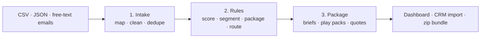

# intake-to-playbook

**Turn messy intake data into scored accounts, priced packages and ready-to-run sales plays, using rules anyone on the team can read and edit.**

Sales and customer teams receive data from everywhere: web forms, event badge scans, inbound emails, partner referrals, CRM exports, product analytics and support tools. This project automates the path from that raw intake to the deliverables a rep actually uses:



1. **Intake** loads every source, renames fields, coerces types (`"$1.2M"`, `"200-500"`, `"10/09/2026"`, `"Yes"`), normalizes values (`USA` → `us`, `HIPPA` → `hipaa`), merges duplicates across sources (`Cedar & Pine Outfitters` = `Cedar and Pine Outfitters`), and records every data-quality issue instead of failing.
2. **Rules** run staged YAML rules that score, segment, choose a package and add-ons, and route each account to a sales play. Every rule that fires is logged, so every recommendation explains itself.
3. **Package** writes a one-page brief per account (snapshot, scores, *why*, priced package, dated next steps, personalized talk track, to-dos), a play pack per play (ranked target list, sequence, talk track, objection handling), a CRM import file, a data-quality report, a dashboard and a zip of everything.

No database, no service, no lock-in: Python + YAML. Changing the business logic means editing a YAML file, not code.

## Three sample projects

All companies, people and products below are fictional.

| Sample | Intake | Rules decide | Deliverables |
|---|---|---|---|
| [**01 · SaaS inbound lead routing**](samples/01-saas-inbound) | Web demo form (CSV), trade-show badge scans (JSON), sales@ inbox (free text) | Fit + intent scores, segment, plan + add-ons, route to one of 6 plays | [Dashboard](examples/01-saas-inbound/index.html) · [example brief](examples/01-saas-inbound/accounts/LEAD-001-harborline-freight-inc.md) · [play pack](examples/01-saas-inbound/plays/competitive-switch.md) |
| [**02 · Managed IT quote packaging**](samples/02-msp-rfq-packaging) | Quote portal (CSV), intake inbox (text), referral partners (JSON) | Service tier, compliance add-ons (HIPAA, PCI, CMMC, SOC 2), urgency, budget gap, partner overlay | [Dashboard](examples/02-msp-rfq-packaging/index.html) · [example brief](examples/02-msp-rfq-packaging/accounts/RFQ-003-ridgeview-precision-machining.md) · [play pack](examples/02-msp-rfq-packaging/plays/rapid-proposal.md) |
| [**03 · Renewals & expansion desk**](samples/03-renewals-expansion) | CRM accounts, product usage, support summary, CSM notes | Health / risk / expansion scores, seats sized to real usage, upgrade vs right-size, churn rescue vs expansion | [Dashboard](examples/03-renewals-expansion/index.html) · [example brief](examples/03-renewals-expansion/accounts/ACCT-002-brookfield-health-partners.md) · [play pack](examples/03-renewals-expansion/plays/churn-rescue.md) |

The `examples/` folder holds the committed output of each sample, so you can browse the deliverables without running anything. (GitHub shows the dashboards as source; download them to view, or run locally.)

## Quick start

```bash
pip install -r requirements.txt          # just PyYAML
python -m playbook samples/*             # run all three samples into ./out
open out/01-saas-inbound/index.html      # dashboard linking every deliverable
python -m unittest discover tests        # 11 tests
```

```
Inbound Lead Routing — Cobalt Ops
  intake   21 records from 3 sources -> 18 accounts, 3 data issues
  plays    Enterprise account-based play: 5, Nurture: 5, Self-serve trial: 3, Fast-track demo: 2, ...
```

## What a rule looks like

```yaml
- id: fit-senior-buyer
  when: {field: title, matches: "\\b(chief|vp|head of|director|founder)\\b"}
  then: {score: {fit: 15}, tag: decision-maker}
  reason: "{title} is likely a decision-maker"

- id: tier-secure-plus
  when: {any: [{field: compliance, contains_any: [cmmc, nist 800-171]},
               {field: endpoints, gte: 150}]}
  then: {package: secure-plus}
  reason: "CMMC/NIST or 150+ devices → Secure Plus"
```

That rule then shows up in the account brief as an explanation:

```
## Why this recommendation
- Fit · VP Operations is likely a decision-maker → fit +15
- Intent · Requested a demo → intent +30
- Route · Enterprise account with strong fit → account-based play → play=enterprise-abm
```

**Operators:** `eq ne in not_in gt gte lt lte between exists missing contains contains_any contains_all matches is_true`, combined with `all` / `any` / `not`. Compare against another field with `{ref: field}`.

**Actions (`then`):** `set` fields · `copy` a field · `score` named scores · `tag` · `flag` a to-do · `play` · `package` · `addons` · `stop`.

**Stages** run in order. `first_match: true` makes a stage a router, `else` sets a default, and a stage-level `when` skips stages that don't apply. **Computed fields** (`days_until`, `days_since`, `ratio`, `sum`, `count`, `max`, `coalesce`, `scale`) are calculated before rules run. **Rules are validated** before every run: a typo in a play name, package, score or operator stops the run with a clear message.

## Build your own project

```
my-project/
├── project.yaml    # sources + field maps, schema (types), value maps, dedupe keys, brief/CRM fields
├── rules.yaml      # scores, computed fields, staged rules, score bands
├── plays.yaml      # play library: objective, owner, SLA, sequence, talk track, questions, objections
├── packages.yaml   # (optional) tiers, per-unit pricing, add-ons, discounts, term
└── data/           # raw CSV / JSON / text exports
```

Copy the closest sample, swap in your exports and edit the YAML. Play templates can use any field (`"Call {first_name} about {current_tool}"`). A missing value appears as `[current tool]`, so reps can see what to fill in.

## Project layout

```
playbook/intake.py     loaders, type coercion, normalization, dedupe/merge
playbook/rules.py      condition evaluator, computed fields, staged rule engine, validator
playbook/packager.py   pricing, account briefs, play packs, CRM CSV, dashboard, zip
playbook/__main__.py   CLI
samples/               three end-to-end sample projects
examples/              committed outputs of the samples
tests/                 unit + end-to-end tests
```
