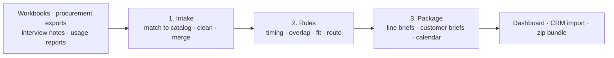

# intake-to-playbook

**Turn a consultant's messy software inventory into a renewal calendar, competitive alternatives and next-step sales plays for every customer, driven by rules anyone on the team can read and edit.**

Consultants who resell, advise on and implement software collect each customer's ISV estate from everywhere: discovery workshops, procurement exports, interview notes and admin-console usage reports. The same product shows up as `SFDC`, `Salesforce Enterprise` and `Salesforce`, and the same customer as `Brightwater CU` and `Brightwater`. This project turns all of that into:

- **one line per product per customer**, with canonical names, vendor, category, spend, licenses vs active users, renewal date and **auto-renew notice deadline**
- **competitive alternatives** for every line, highlighting the ones you resell or implement
- **a next-step sales play** for every line (consolidate, competitive swap, license optimization, renewal negotiation, own the renewal, or monitor) with **your estimated revenue**
- **a software estate brief per customer**: spend, renewals in the next 90/180 days, overlapping tools, opportunities by play, dated next steps
- **a renewal calendar across all customers**, plus a CRM import file, data-quality report and dashboard



## The flagship sample: software estate review

[`samples/01-isv-inventory`](samples/01-isv-inventory) is a fictional consultancy with four fictional customers. It takes 48 raw records from 4 sources and turns them into 36 product lines and about $490K of identified consultant opportunity.

| Input | What's messy about it |
|---|---|
| [`discovery_workbook.csv`](samples/01-isv-inventory/data/discovery_workbook.csv) | Two customers in one sheet, per-user vs annual pricing, `Y` / `Yes`, `TBD` dates, a duplicate row |
| [`halcyon_procurement_export.json`](samples/01-isv-inventory/data/halcyon_procurement_export.json) | PO line descriptions like `CrowdStrike Falcon Enterprise` and `Okta Workforce Identity - SSO + MFA` |
| [`pemberton_interview_notes.txt`](samples/01-isv-inventory/data/pemberton_interview_notes.txt) | Free-text notes from stakeholder interviews |
| [`license_usage_export.csv`](samples/01-isv-inventory/data/license_usage_export.csv) | Active users from admin consoles, with different customer and app names |
| [`reference/isv_catalog.yaml`](samples/01-isv-inventory/reference/isv_catalog.yaml) | Your catalog: canonical names, aliases, categories, alternatives, partner status, resale margins, and which suites already cover a product |

What the rules find, for example:

- **Northbeam Logistics** pays $72K/yr for Slack and $66K/yr for Zoom while Teams comes with its Microsoft 365 E3. Both get the *Consolidate* play, timed to auto-renew notice deadlines 17 and 32 days out.
- **Halcyon Health Group** owns Microsoft 365 E5, which includes endpoint security, identity and BI. Its CrowdStrike, Okta and Tableau renewals become consolidation projects. Its Webex notice deadline has **already passed**, so that line is flagged.
- Northbeam rated **Salesforce 2/5** and is evaluating HubSpot, which the consultant resells, so it gets a *Competitive swap* worth migration fees plus first-year resale margin.
- **Zendesk** at Halcyon has 54 of 150 agent seats idle, so it gets *License optimization* with the fee tied to savings.

Browse the generated output: [dashboard](examples/01-isv-inventory/index.html) · [renewal calendar](examples/01-isv-inventory/calendar.md) · [customer brief](examples/01-isv-inventory/customers/northbeam-logistics.md) · [line brief](examples/01-isv-inventory/lines/SW-003-slack-business-northbeam-logistics.md) · [play pack](examples/01-isv-inventory/plays/consolidate.md)

### The plays

| Play | When it fires | Consultant revenue (illustrative) |
|---|---|---|
| Consolidate onto what they own | A suite the customer owns covers the product, or two tools overlap in a category | Fixed-fee migration |
| Competitive swap to a partner ISV | Satisfaction ≤ 2 or already evaluating, and you have a partner alternative | Migration + first-year resale margin |
| License optimization | ≥ 10 licenses and < 75% used, renewing within 270 days | Share of verified savings |
| Renewal negotiation | ≥ $75K renewing within 270 days (≥ $250K within 365) | Share of negotiated savings |
| Own the renewal | You resell it and it renews within 180 days | Resale margin |
| Monitor | Nothing to do yet | Reminder 180 days before renewal |

Every threshold, rate and alternative lives in YAML ([`rules.yaml`](samples/01-isv-inventory/rules.yaml), [`plays.yaml`](samples/01-isv-inventory/plays.yaml), [`packages.yaml`](samples/01-isv-inventory/packages.yaml), [`isv_catalog.yaml`](samples/01-isv-inventory/reference/isv_catalog.yaml)). Margins, fees and positioning in the sample are placeholders: swap in your own partner agreements.

## Quick start

```bash
pip install -r requirements.txt                 # just PyYAML
python -m playbook samples/01-isv-inventory     # writes ./out/01-isv-inventory
open out/01-isv-inventory/index.html            # dashboard linking every deliverable
python -m unittest discover tests               # 14 tests
```

To use your own data, copy `samples/01-isv-inventory`, drop your exports into `data/`, point `project.yaml` at them (one `map:` per source to rename columns), and extend `reference/isv_catalog.yaml` with the products your customers run. Products that aren't in the catalog are listed in `data_quality.md` so you know what to add.

## How a rule reads

```yaml
- id: sig-covered
  when: {all: [{field: covered_by_suites, exists: true},
               {field: customer_products, contains_any: {ref: covered_by_suites}}]}
  then: {score: {opportunity: 30}, tag: already-owned-alternative, copy: {consolidate_onto: covered_by}}
  reason: "Customer already owns {covered_by} through a suite they pay for"
```

Every rule that fires shows up in the line brief, so each recommendation explains itself:

```
## Why this recommendation
- Renewal timing · Renews in 62 days → urgency +40
- Auto-renew · Auto-renew notice due in 32 days → urgency +30
- Signals · Customer already owns Microsoft Teams through a suite they pay for → opportunity +30
- Route · Overlap with tools already owned → consolidation → play=consolidate
```

**Operators:** `eq ne in not_in gt gte lt lte between exists missing contains contains_any contains_all matches is_true`, combined with `all` / `any` / `not`. Compare against another field with `{ref: field}`.

**Actions:** `set` · `copy` · `score` · `tag` · `flag` (to-do) · `play` · `package` · `addons` · `stop`.

**Computed fields** run before rules: per line (`days_until`, `date_minus_days`, `ratio`, `product`, `difference`, `scale`, `coalesce`, `template`, …) and **across lines** (`count`, `sum`, `values` grouped by customer or category). Cross-line fields are how the engine knows a customer owns two tools in the same category, or already pays for the suite that covers a product.

**Stages** run in order. `first_match: true` makes a stage a router, `else` sets a default, and a stage-level `when` skips stages that don't apply. Rules are validated before every run, so a typo in a play, package, score or operator stops the run with a clear message.

## More samples

The engine is general-purpose. Three more samples show it on other intake problems:

| Sample | Intake → deliverables |
|---|---|
| [02 · SaaS inbound lead routing](samples/02-saas-inbound) | Web form + badge scans + sales inbox → fit/intent scores, plan pricing, 6 routing plays |
| [03 · Managed IT quote packaging](samples/03-msp-rfq-packaging) | Quote portal + inbox + partner referrals → service tier, compliance add-ons, 36-month price, budget check |
| [04 · Renewals & expansion desk](samples/04-renewals-expansion) | CRM + usage + support + CSM notes → health/risk/expansion, usage-sized renewal quotes, churn rescue vs expansion |

Run them all with `python -m playbook samples/*`.

## Project layout

```
playbook/intake.py     loaders (CSV, JSON, free text), type coercion, catalog lookups, dedupe/merge
playbook/rules.py      condition evaluator, computed + cross-line fields, staged rule engine, validator
playbook/packager.py   pricing/opportunity, line briefs, roll-up briefs, calendar, play packs, CRM CSV, dashboard
playbook/__main__.py   CLI
samples/               four end-to-end sample projects
examples/              committed output of every sample
tests/                 unit + end-to-end tests
```

All companies and people in the samples are fictional. Product names belong to their respective owners; catalog alternatives, margins and fees are illustrative assumptions.
